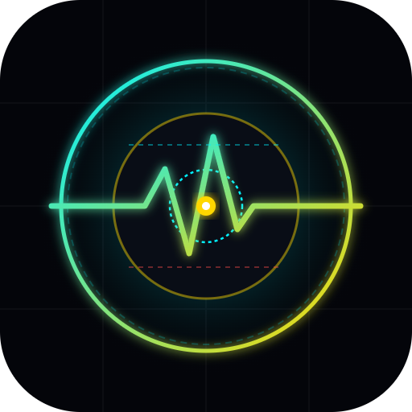

<div align="center">
  
  <h1>librelinkup-monitor</h1>
  <p><strong>Autonomous Continuous Glucose Monitoring (CGM) companioning for Abbott FreeStyle Libre sensors</strong></p>
  <p><em>Engineered for the <a href="https://hermes-agent.nousresearch.com">Hermes Agent</a> ecosystem by Syzygy Studios & the Nous Research Community</em></p>
</div>

<br />

---

## ⚠️ Legal & Medical Disclaimers

### 1. NOT MEDICAL SOFTWARE
**This software is for informational, experimental, and educational companioning purposes only.** It is **NOT a medical device**, has not been evaluated, cleared, or approved by the U.S. FDA or any regulatory authority, and must **never replace professional medical monitoring, clinical diagnosis, or standard fingerstick blood glucose meters**. Do NOT use this software as the sole or primary basis for insulin dosing or acute clinical decisions.

### 2. NON-AFFILIATION & TRADEMARKS
This tool is independent open-source software and is **NOT affiliated with, sponsored by, authorized by, or endorsed by Abbott Laboratories, FreeStyle Libre, or LibreView**. "FreeStyle Libre" and "LibreLinkUp" are registered trademarks of Abbott Laboratories.

---

## Highlights

- **Zero-Cost Telemetry Hashing ($0.00 Token Burn):** Emits a byte-stable state (`state=QUIET`) during normal readings. Hermes cron hashes the stdout; when unchanged, LLM execution is skipped completely. The agent is only woken when an acute low or rapid drop occurs.
- **Inverted Overnight Asymmetry:** Protects against alarm fatigue. Unattended overnight lows are life-threatening emergencies; unattended overnight highs are manageable the next day. The monitor watches lows and rapid falling trends only, keeping routine overnight highs silent.
- **Failure Smoothing:** Transient network blips, sensor warmup latency, or cloud API glitches collapse to `state=QUIET` until consecutive poll failures reach a threshold (default 3 ticks).
- **Secondary Caregiver Integration:** Connects strictly through the secondary caregiver LibreLinkUp API, leaving the patient's primary mobile Bluetooth scanning session completely undisturbed.

---

## 🤖 One-Click Setup (Paste to Your Hermes Agent)

The fastest, error-free way to configure this skill is to let your Hermes Agent act as your setup wizard. Copy and paste this block directly into your Hermes chat:

```text
Please install and set up the librelinkup-monitor skill for me:
1. Ensure `pylibrelinkup` is installed in my Python environment (`pip install pylibrelinkup`).
2. Guide me through setting up my secondary caregiver LibreLinkUp credentials:
   - Ask for my secondary caregiver email and password (remind me not to use my primary patient account, and that the caregiver account must be registered as age 18+).
   - Confirm my preferred alert thresholds (defaults: soft low 85 mg/dL, critical low 70 mg/dL, rapid drop ceiling 130 mg/dL).
   - Save the configuration securely to my local path (e.g. ~/.config/librelinkup/creds.json or %LOCALAPPDATA%\hermes\libre_creds.json) without echoing secrets to chat.
3. Run `python scripts/glucose_watch.py --test` to verify that the boundary test suite passes (9/9).
4. Run `python scripts/glucose_watch.py --test-auth` to verify live authentication with the LibreLinkUp cloud.
5. Schedule the 15-minute Hermes monitor cron job using the specification in `templates/cron_job.example.json`.
```

---

## Manual Quick Start

### 1. Install Dependencies
```bash
python -m pip install pylibrelinkup
```

### 2. Configure Credentials
Copy `templates/libre_creds.example.json` to your configuration path (e.g. `~/.config/librelinkup/creds.json` or `%LOCALAPPDATA%\hermes\libre_creds.json`):

```json
{
  "email": "caregiver_account@example.com",
  "password": "CaregiverPassword123!",
  "low_threshold": 85.0,
  "crit_threshold": 70.0,
  "fall_threshold": 130.0,
  "watch_from_hour": 22,
  "watch_to_hour": 8,
  "error_after_fails": 3
}
```

### 3. Verify Connection
```bash
# Run synthetic verification tests
python scripts/glucose_watch.py --test

# Test authentication with LibreLinkUp cloud
python scripts/glucose_watch.py --test-auth
```

### 4. Schedule Hermes Cron Monitor
```bash
hermes cron create \
  --name "Glucose Watch (LibreLinkUp 15m)" \
  --interval 15m \
  --monitor-script "scripts/glucose_watch.py" \
  --prompt "You were WOKEN because the glucose digest CHANGED. Re-pull numbers with pylibrelinkup. On LOW/CRITICAL: message immediately with value, trend, and fast sugar triage (sit down first). On QUIET: reply [SILENT]."
```

---

## Documentation

- **[SKILL.md](SKILL.md)**: Full Hermes Skill specification and multi-tier alert escalation matrix.
- **[FAQ.md](FAQ.md)**: Comprehensive User Guide, operational FAQ, and legal indemnification agreement.
- **[references/gotchas_and_failure_modes.md](references/gotchas_and_failure_modes.md)**: Operational pitfalls (trend enum inversion, nested JSON paths, 400 mg/dL ceiling, Samsung DND Sleep Mode).
- **[references/api_reference.md](references/api_reference.md)**: LibreLinkUp REST API protocol, headers, and payloads.

## License

MIT (c) 2026 Nous Research Community & Syzygy Studios
